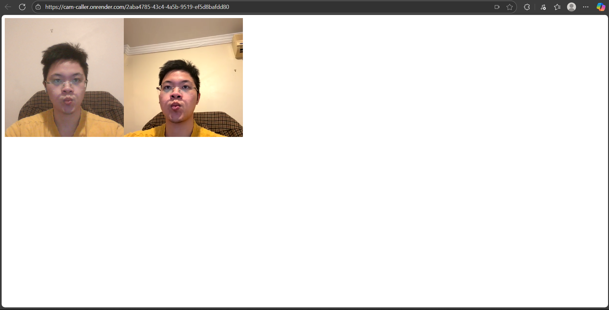

# Cam-caller

P2P video calling via WebRTC with a dedicated PeerJS signaling server.
Share the exact URL you’re on so others join the same room; sharing only the base URL puts them in a different room.

**Live demo:** https://cam-caller.onrender.com
**Peer Server:** https://peer-server-m6ay.onrender.com

## Screenshot



> Current state: “Works on some devices and not on others… Could not debug ICE error.”  
> This README focuses on reproducible local runs, production hardening, and WebRTC diagnostics.

---

## Contents

- Architecture  
- Folder structure  
- Prerequisites  
- Quickstart  
- How the client is served  
- Ports and paths  
- Production notes  
- TURN / ICE configuration  
- Troubleshooting  
- Known issues and bugs  
- Testing matrix  
- Roadmap  
- Repo hygiene  
- License

---

## Architecture

Two runtime processes:

1) peer-server — PeerJS signaling server (WebSocket) used to broker peer IDs and exchange SDP/ICE candidates  
2) server — Express + EJS app that serves pages and the client-side JS

The client code lives under client/ and is served by the Express app (no separate dev server).  
Media flows P2P over WebRTC; signaling flows via PeerJS.

---

## Folder structure

```
Cam-caller/
├─ client/        # Client-side JS/CSS that the Express app serves
├─ peer-server/   # PeerJS signaling server
├─ server/        # Express + EJS web app
├─ .gitignore
└─ README.md
```

---

## Prerequisites

- Node.js 18+ and npm  
- Modern browser with WebRTC (Chrome, Edge, Firefox, Safari)  
- HTTPS origin for camera/mic on real devices (localhost is exempt)  
- Open local ports (defaults used below: 3000 for app, 3001 for peer server)

---

## Quickstart

Two processes only. No .env files required.

### PeerJS signaling server

```bash
cd peer-server
npm install
npm start    # default: http://localhost:3001/peerjs
```

### App server (Express + EJS)

```bash
cd server
npm install
npm start    # default: http://localhost:3000
```

Open: http://localhost:3000

---

## How the client is served

- The Express app renders EJS views and serves the client JS/CSS directly from client/ (or its subfolders).  
- No separate client dev server is used.  
- If ports/paths differ, update the PeerJS client options in the served JS to match.

PeerJS client example:

```js
const peer = new Peer(undefined, {
  host: location.hostname,
  port: 3001,
  path: '/peerjs',
  secure: false   // set true with HTTPS in production
});
```

---

## Ports and paths

- App server: http://localhost:3000  
- Peer server: http://localhost:3001/peerjs

Change ports/paths directly in code if required; this project does not assume environment variables.

---

## Production notes

- Serve the app over HTTPS.  
- Expose the peer server over wss on 443 with a consistent path (e.g., /peerjs).  
- If the peer server is on a different origin, ensure CORS and WebSocket upgrades are allowed, and that both origins are HTTPS.

PeerJS client example for production behind HTTPS:

```js
const peer = new Peer(undefined, {
    host: 'peer-server-m6ay.onrender.com',
    port: 443,
    path: '/peerjs',
    secure: true
});
```

---

## TURN / ICE configuration

STUN-only fails on many mobile/corporate networks and symmetric NATs. Add at least one TURN server, preferably turns: on TCP/443.

Client config example with TURN:

```js
const peer = new Peer(undefined, {
  host: 'your-domain.example',
  port: 443,
  path: '/peerjs',
  secure: true,
  config: {
    iceServers: [
      { urls: 'stun:stun.l.google.com:19302' },
      {
        urls: ['turns:turn.your-domain.example:443?transport=tcp'],
        username: 'turnuser',
        credential: 'turnpass'
      }
    ]
  }
});
```

Without TURN, expect intermittent failures on mobile, corporate, and symmetric NATs.

---

## Troubleshooting

1) Origin security  
   - Localhost works without HTTPS. Real devices require HTTPS.

2) Peer server reachability  
   - Open http://localhost:3001 and expect a response (Cannot GET / which means it is running).  
   - In production use https://peer-server-m6ay.onrender.com and ensure it responds over TLS.

3) WebSocket upgrade  
   - Check browser DevTools → Network for a 101 Switching Protocols on the PeerJS path.

4) ICE diagnostics  
   - Watch console for “ICE failed” or “connectionState: failed”.  
   - Temporarily force relay to validate TURN:

```
config: { iceTransportPolicy: 'relay', iceServers: [ /* TURN */ ] }
```

5) Safari/iOS specifics  
   - Require a user gesture before getUserMedia.  
   - Ensure mic/camera permissions are granted.

6) Mixed content  
   - Do not call ws:// or http:// from an https:// page. Use wss://.

7) Time drift  
   - Large system clock skew can break TLS and auth; keep clocks in sync.

---

## Known issues and bugs

- Intermittent call setup failure on some devices and networks due to missing TURN.  
- Mixed-content or non-secure contexts can block media and signaling when deployed without HTTPS.  
- iOS Safari may deny media without an explicit user gesture.  
- iOS Safari may show no local self-preview; the remote peer still receives video. Ensure video elements use playsinline and (for autoplay) muted.
- If the peer server runs on a different origin without TLS, browsers will refuse ws:// from an https:// page.

---

## Testing matrix

| Scenario                       | Expectation             | Status |
|--------------------------------|-------------------------|--------|
| Chrome ↔ Chrome, same LAN      | Connects with STUN      | ✓      |
| Mobile 4G ↔ Home Wi-Fi         | Requires TURN on 443    | ✓       |
| Safari iOS ↔ Chrome desktop    | Works after gesture     | ✓       |
| Corp NAT ↔ Corp NAT            | TURN mandatory          | ☐      |

Note: Even if the mobile device shows no local camera preview, the laptop peer still receives and renders the mobile video.

---

## Roadmap

- Add minimal logs around call setup and ICE state.  
- Provide a basic “collect logs” UI for troubleshooting.  
- Add .env.example only if/when env-based config is introduced.  
- Document TURN deployment (coturn or managed provider).  
- Add CI smoke test using headless browsers for SDP/ICE flow.

---

## Repo hygiene

- Add a LICENSE (MIT recommended) if you want reuse.  
- Document where ports/paths are set in code for quick changes.

---

## License

MIT License © 2025 Don Lam. See LICENSE for full text.